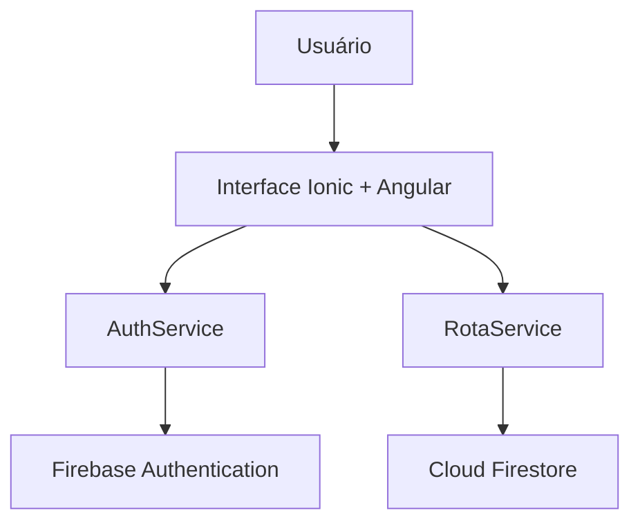

# 🚌 Liga Ônibus IFSC


## 📖 Sobre o projeto

O **Liga Ônibus IFSC** é uma aplicação desenvolvida com o objetivo de facilitar o acompanhamento das rotas de transporte utilizadas pelos estudantes do Instituto Federal de Santa Catarina (IFSC), com foco no município de Garopaba.

A plataforma permite que os usuários consultem horários, acompanhem a situação das rotas e registrem atrasos de maneira colaborativa, centralizando informações importantes sobre o transporte estudantil.

O projeto utiliza Ionic e Angular para a construção da interface, Firebase Authentication para o gerenciamento de usuários e Cloud Firestore para o armazenamento e atualização das informações das rotas.

## 🎯 Objetivos

- Facilitar o acesso às informações do transporte estudantil.
- Melhorar a comunicação entre os estudantes.
- Centralizar informações sobre rotas, horários e atrasos.
- Possibilitar o compartilhamento colaborativo de informações.
- Reduzir a incerteza relacionada aos horários dos ônibus.

## ⚙️ Funcionalidades

### Autenticação

- Cadastro de usuários com e-mail e senha.
- Login com e-mail e senha.
- Login utilizando uma conta Google.
- Gerenciamento do estado de autenticação.
- Encerramento de sessão implementado no serviço de autenticação.
- Redirecionamento de usuários não autenticados.
- Tratamento de erros de autenticação em português.

### Consulta de rotas

- Listagem das rotas cadastradas no Cloud Firestore.
- Visualização dos horários dos ônibus.
- Identificação da situação de cada rota.
- Ordenação das rotas pelo tempo de atraso.

As rotas podem apresentar os seguintes estados:

| Estado | Descrição |
|---|---|
| No horário | Rota sem atraso registrado. |
| Atrasado | Rota com atraso informado pelos usuários. |
| Rota concluída | Rota marcada como finalizada. |

### Registro de atrasos

- Seleção da rota que apresenta atraso.
- Informação do tempo de atraso em minutos.
- Validação de valores inteiros e positivos.
- Atualização das informações no Cloud Firestore.
- Feedback de sucesso ou erro.
- Redirecionamento para a página inicial após o registro.

## 🛠️ Tecnologias utilizadas

| Tecnologia | Versão | Finalidade |
|---|---|---|
| Angular | 22.1.7 | Estrutura da aplicação |
| Ionic | 9.x | Interface multiplataforma |
| TypeScript | 6.0.x | Linguagem de programação |
| Firebase | 13.x | Integração com serviços em nuvem |
| Firebase Authentication | — | Autenticação de usuários |
| Cloud Firestore | — | Banco de dados NoSQL |
| Capacitor | 8.5.2 | Suporte à integração nativa |
| RxJS | 7.8.x | Programação reativa |
| HTML5 | — | Estrutura das interfaces |
| SCSS | — | Estilização das interfaces |

## 📂 Estrutura do projeto

Principais arquivos e diretórios da aplicação:

```text
ligao-onibus-ifsc/
├── src/
│   └── app/
│       ├── atraso/
│       │   ├── atraso.page.html
│       │   ├── atraso.page.scss
│       │   └── atraso.page.ts
│       ├── cadastro/
│       │   ├── cadastro.page.html
│       │   ├── cadastro.page.scss
│       │   └── cadastro.page.ts
│       ├── home/
│       │   ├── home.page.html
│       │   ├── home.page.scss
│       │   └── home.page.ts
│       ├── login/
│       │   ├── login.page.html
│       │   ├── login.page.scss
│       │   └── login.page.ts
│       ├── models/
│       │   └── rota.ts
│       ├── services/
│       │   ├── authService.ts
│       │   └── rotaService.ts
│       ├── firebase.config.ts
│       └── app.routes.ts
└── package.json
```

A aplicação utiliza componentes standalone do Angular e carregamento sob demanda das páginas (lazy loading).

## 🏗️ Arquitetura

O projeto é organizado em três camadas principais:

- **Pages:** interfaces e interação com os usuários.
- **Services:** autenticação, consulta e atualização de dados.
- **Models:** definição e tipagem das entidades da aplicação.



Essa organização permite separar as responsabilidades da aplicação, facilitando sua manutenção e evolução.

## 🗄️ Banco de dados

O projeto utiliza o Cloud Firestore, um banco de dados NoSQL disponibilizado pelo Firebase.

As informações das rotas são armazenadas na coleção `garopaba`.

### Modelo de dados

```typescript
export interface Rota {
  id: string;
  atrasado: boolean;
  concluida: boolean;
  horario: string;
  rota: string;
  tempo?: number;
}
```

| Campo | Tipo | Descrição |
|---|---|---|
| id | string | Identificador do documento |
| atrasado | boolean | Indica se a rota está atrasada |
| concluida | boolean | Indica se a rota foi concluída |
| horario | string | Horário previsto da rota |
| rota | string | Identificação da rota |
| tempo | number | Tempo de atraso em minutos (opcional) |

### Exemplo de documento

```json
{
  "rota": "Centro - IFSC",
  "horario": "07:20",
  "atrasado": true,
  "concluida": false,
  "tempo": 15
}
```

## 🚀 Como executar o projeto

### Pré-requisitos

Antes de executar a aplicação, é necessário possuir:

- Node.js compatível com a versão do Angular.
- NPM.
- Git.
- Um projeto configurado no Firebase.

### 1. Clonar o repositório

```bash
git clone https://github.com/PietroFachini/liga-onibus-if.git
```

### 2. Acessar o diretório do projeto

```bash
cd liga-onibus-if/ligao-onibus-ifsc
```

### 3. Instalar as dependências

```bash
npm install
```

### 4. Configurar o Firebase

Acesse o [Firebase Console](https://console.firebase.google.com/) e realize as seguintes configurações:

1. Crie um projeto no Firebase.
2. Registre uma aplicação Web.
3. Habilite o Firebase Authentication.
4. Habilite os provedores de e-mail/senha e Google.
5. Crie um banco de dados no Cloud Firestore.
6. Crie uma coleção chamada `garopaba`.
7. Cadastre os documentos referentes às rotas.
8. Configure as regras de segurança do Firestore.
9. Atualize as configurações em:

```text
src/app/firebase.config.ts
```

Certifique-se de que o domínio utilizado pela aplicação esteja autorizado no Firebase Authentication.

### 5. Executar a aplicação

```bash
npm start
```

A aplicação estará disponível, por padrão, em:

```text
http://localhost:4200
```

Também é possível utilizar o Ionic CLI:

```bash
npm install -g @ionic/cli
ionic serve
```

## 📦 Comandos disponíveis

| Comando | Descrição |
|---|---|
| `npm start` | Inicia o servidor de desenvolvimento |
| `npm run build` | Compila a aplicação |
| `npm run watch` | Compila e monitora alterações |
| `npm test` | Executa os testes |
| `npm run lint` | Executa a análise estática do código |

## 🧭 Rotas da aplicação

| Rota | Descrição |
|---|---|
| `/` | Redirecionamento para o login |
| `/login` | Autenticação do usuário |
| `/cadastro` | Cadastro de novos usuários |
| `/home` | Visualização das rotas e seus estados |
| `/atraso` | Registro de atrasos |

## 🔒 Segurança

A autenticação é realizada utilizando o Firebase Authentication, evitando o armazenamento direto de senhas pela aplicação.

As páginas de consulta de rotas e registro de atrasos verificam o estado de autenticação do usuário.

As permissões de leitura e escrita devem ser controladas pelas regras de segurança do Cloud Firestore, garantindo que somente usuários autorizados possam realizar operações no banco de dados.

## 📌 Possíveis melhorias futuras

- [ ] Notificações push sobre atrasos.
- [ ] Atualização automática das rotas em tempo real.
- [ ] Histórico de atrasos.
- [ ] Localização dos ônibus por GPS.
- [ ] Integração com mapas.
- [ ] Painel administrativo.
- [ ] Suporte a diferentes municípios e campi.
- [ ] Mecanismos de confirmação de atrasos pela comunidade.
- [ ] Disponibilização do aplicativo para Android e iOS.

## 🤝 Contribuições

Contribuições, sugestões e melhorias são bem-vindas.

Para contribuir:

1. Faça um fork do repositório.
2. Crie uma branch para sua alteração.
3. Realize as modificações.
4. Faça um commit.
5. Envie as alterações para seu fork.
6. Abra um Pull Request.

## 👨‍💻 Desenvolvimento

Projeto voltado à comunidade estudantil do Instituto Federal de Santa Catarina — IFSC.

**Repositório:** [PietroFachini/liga-onibus-if](https://github.com/PietroFachini/liga-onibus-if)

---

Desenvolvido com Ionic, Angular e Firebase.
